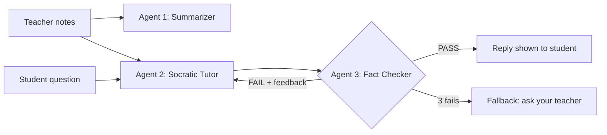

# 🎓 Agent 0: The Multi-Agent AI Tutor

**Colleague Zero Hackathon 2026 Submission**

## 💡 The Problem: The Education Gap & AI Shortcuts
1. **Teachers are overwhelmed** and cannot provide 1-on-1 tutoring to every student.
2. **Parents are exhausted** after long shifts and often can't help with homework.
3. **Students use generic AI (like ChatGPT) to get direct answers.** These tools draw on the open internet and ignore what the teacher actually taught and marks.

## 🛡️ The Solution: A "Walled Garden" Digital Colleague
**Agent 0** is a privacy-first, multi-agent AI tutor. It uses **only the teacher's own lesson notes** as its source of truth, guides students with questions instead of handing over answers, and checks every reply against the notes before the student sees it.

## 🤖 The 3-Agent Workflow
Built with **PydanticAI**, with a self-correction loop:

1. **Agent 1 (Summarizer):** Turns the teacher's messy notes into a 3-bullet study guide for absent students or parents.
2. **Agent 2 (Socratic Tutor):** Answers student questions using only the notes, and is instructed to guide with questions rather than give the direct answer.
3. **Agent 3 (Fact Checker):** Grades the Tutor's reply against the notes (PASS / FAIL). On FAIL, the Tutor retries with the checker's feedback, up to 3 attempts. If every attempt fails, the student sees a fallback ("ask your teacher") instead of an unverified answer.

## ✅ Working Today
- Streamlit Teacher Portal and Student Portal
- Summarizer, Tutor and Fact Checker agents with a live status panel
- Self-correction loop (up to 3 retries) with a safe fallback
- Fully local inference through Ollama (no student data leaves the machine)
- Model/endpoint settings are configurable in the UI (OpenAI-compatible API)

## 🚧 Planned / Not Yet Built
- Evidence-quote verification: the Tutor cites exact quotes and code checks they exist in the notes
- Planner agent that chooses a route per student message
- Teacher approval step before students see a lesson
- Gaps dashboard (questions the notes didn't cover)
- Benchmark with measured results
- vLLM on AMD Instinct: the app uses the OpenAI-compatible standard, so this should be possible, but it has **not been tested**

## ⚠️ Known Limitations
- The "don't give the answer" behavior is prompt-based, not enforced by code.
- The Fact Checker is itself an LLM (Llama 3.2 3B), so it can misjudge.
- State is in-memory (`st.session_state`) and resets when the tab closes. There is no database.
- Text notes only (no PDF or image upload yet).
- Runs locally; there is no hosted deployment.

## 🛠️ Tech Stack
- **Frontend:** Streamlit
- **Agents:** PydanticAI (sequential agent calls with a retry loop)
- **LLM:** Llama 3.2 via Ollama, served through an OpenAI-compatible endpoint

## 🚀 How to Run Locally
1. Clone this repository.
2. Install dependencies: `pip install streamlit "pydantic-ai-slim[openai]" openai`
3. Install [Ollama](https://ollama.com), then download the model: `ollama pull llama3.2`
4. Make sure Ollama is running in the background (`ollama serve`, or the desktop app).
5. Start the app: `python -m streamlit run app.py`
6. Open the Teacher Portal, paste notes, generate the summary, then switch to the Student Portal and ask a question.
