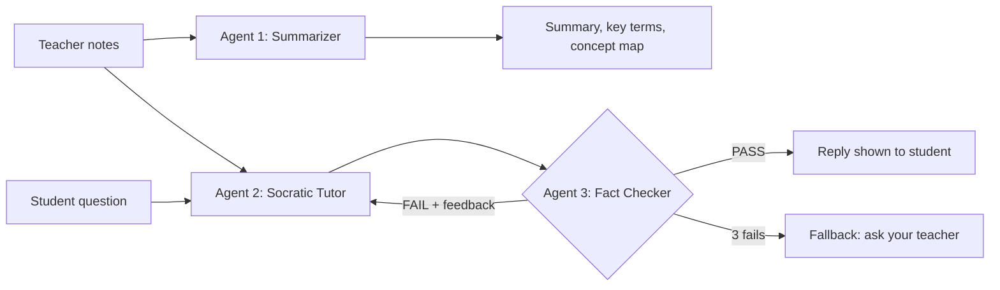

# 🎓 Agent 0: The Multi-Agent AI Tutor

**Colleague Zero Hackathon 2026 Submission**

> A digital colleague for teachers: it learns from the teacher's own notes, guides students with questions, and checks every reply before the student sees it.

## 💡 The Problem: The Education Gap & AI Shortcuts
1. **Teachers are overwhelmed** and cannot provide 1-on-1 tutoring to every student.
2. **Parents are exhausted** after long shifts and often can't help with homework.
3. **Students use generic AI (like ChatGPT) to get direct answers.** These tools draw on the open internet and ignore what the teacher actually taught and marks.

## 🛡️ The Solution: A "Walled Garden" Digital Colleague
**Agent 0** is a privacy-first, multi-agent AI tutor. It uses **only the teacher's own lesson notes** as its source of truth, guides students with questions instead of handing over answers, and sends every reply through an AI fact checker before the student sees it.

## 🤖 The 3-Agent Workflow
Built with **PydanticAI**, with a self-correction loop:

1. **Agent 1 (Summarizer):** Turns the teacher's messy notes into a clean 3-bullet study guide, plus **key terms** and a **concept map** for visual learners.
2. **Agent 2 (Socratic Tutor):** Answers student questions using only the notes, guiding with hints and questions rather than the direct answer.
3. **Agent 3 (Fact Checker):** Grades the Tutor's reply against the notes (PASS / FAIL). On FAIL, the Tutor retries with the checker's feedback, up to 3 attempts. If every attempt fails, the student sees a safe fallback ("ask your teacher") instead of an unverified answer.

## ✅ What You Can Try Today
- **Teacher Portal and Student Portal** in a clean Streamlit interface
- **Smart summaries:** bullet-point summary, key terms and a visual concept map
- **Voice notes:** teachers can dictate notes and review the transcript before generating the summary
- **Multilingual by design:** the Summarizer and Tutor reply in the language of the notes or question, including South African languages
- **Socratic tutoring** grounded only in the teacher's notes
- **Self-correction loop:** up to 3 retries with the checker's feedback, then a safe fallback
- **Transparent by design:** each reply shows which attempt Agent 3 approved, and the live status panel shows the checker's verdict
- **Local-first AI:** summarising, tutoring and fact-checking all run on your own machine through Ollama
- **Flexible model setup:** any OpenAI-compatible endpoint can be configured in the UI, so the same app can point at a vLLM server

## 🔒 Privacy
All AI processing runs locally, so lesson notes and student questions stay on the machine. Voice notes are an optional convenience that uses an online speech service. Typing or pasting notes keeps everything local.

## 🚀 Roadmap: What's Next
- **Evidence-quote verification:** the Tutor cites exact quotes and code confirms they exist in the notes
- **Planner agent** that chooses the best route for each student message
- **Teacher approval step** before students see a lesson
- **Gaps dashboard** showing which questions the notes didn't cover
- **Photo notes:** snap a textbook page or handwritten notes
- **Offline speech-to-text** for fully local voice notes
- **Benchmarks on AMD Instinct with vLLM** for classroom-scale deployment
- **Optional persistence** for lessons and progress across sessions

## 🛠️ Tech Stack
- **Frontend:** Streamlit
- **Agents:** PydanticAI (sequential agent calls with a retry loop)
- **LLM:** Llama 3.2 via Ollama, served through an OpenAI-compatible endpoint
- **Voice (optional):** SpeechRecognition
- **Concept maps:** Graphviz, drawn natively by Streamlit

## 📁 Project Structure
- `app.py`: the Streamlit interface and workflow
- `core.py`: prompts, agent construction, verdict parsing and voice transcription, with no Streamlit code so it is easy to test

## ▶️ How to Run Locally
1. Clone this repository.
2. Install dependencies: `pip install streamlit "pydantic-ai-slim[openai]" openai`
3. *(Optional, for voice notes)* `pip install SpeechRecognition`
4. Install [Ollama](https://ollama.com), then download the model: `ollama pull llama3.2`
5. Make sure Ollama is running in the background (`ollama serve`, or the desktop app).
6. Start the app: `python -m streamlit run app.py`
7. Open the Teacher Portal, paste or dictate notes, generate the summary, then switch to the Student Portal and ask a question.
